

  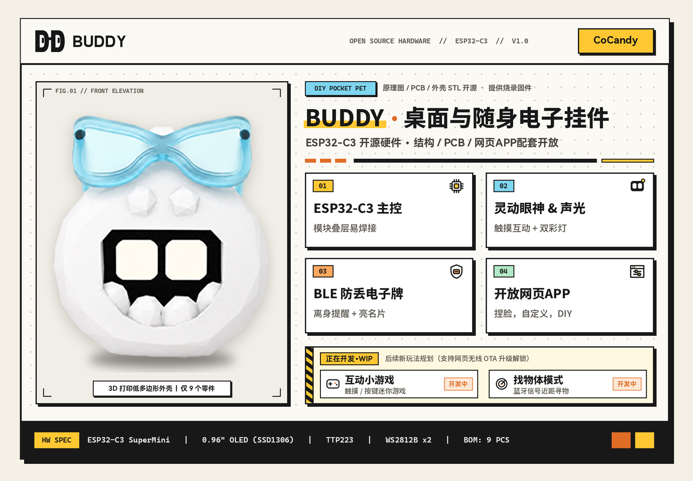

<h1 align="center">BUDDY</h1>

<b>基于 ESP32-C3 的桌面与随身开源电子小挂件：触摸声光互动、吃蓝牙信号升级、防丢亮名牌、浏览器直连实时捏脸</b>

  <a href="#-概览">概览</a> &nbsp;|&nbsp;
  <a href="#-功能与交互">功能与交互</a> &nbsp;|&nbsp;
  <a href="#-实现思路与引脚定义">实现与引脚</a> &nbsp;|&nbsp;
  <a href="#-开放网页端">开放网页端</a> &nbsp;|&nbsp;
  <a href="#-硬件清单与打印">材料清单</a> &nbsp;|&nbsp;
  <a href="#-焊接组装与刷机">组装与刷机</a> &nbsp;|&nbsp;
  <a href="#-二创与折腾指南">二创指南</a> &nbsp;|&nbsp;
  <a href="#-社区与许可证">社区与协议</a>

<a href="README_EN.md"><b>English</b></a>

  
  
  
  
  

---

## 📖 概览

**BUDDY** 是一只基于 **ESP32-C3 SuperMini** 制作的低多边形电子小挂件。平时放在桌边摸摸它的后背，它会眯起弯眼冒爱心、亮起双侧彩灯哼小调；一直连拍逗急了还会竖起眉头生闷气。出门挂在书包或钥匙扣上，它会收集沿途路过的蓝牙广播信号当“糖果”攒经验升级；万一物品遗落断连超时，路人轻碰一下背部就能亮出你的像素联系名牌。

硬件上没有使用难焊的密脚芯片和零碎阻容，而是采用**定制双面底板 + 常用成品小模块叠层焊接**的方案——全机一共只有 **8 种电子器件（合计 9 个元件）**，一把普通电烙铁就能完成焊接。

- **开源部分**：电路原理图与嘉立创 EDA 专业版工程（`.epro2` / Gerber）、3D 打印机身外壳模型（`.stp` / `.3dm` / `.blend`）、GPIO 引脚定义与项目文档按 `CC BY-NC-SA 4.0` 协议完全开源（可搭配开源库 **[Bit-Eye-Lib](https://github.com/ByCoCandy/Bit-Eye-Lib)** 自行编写固件免费折腾）。
- **官方固件与网页端**：配套闭源养成固件支持在 **[home.cocandy.com.cn/flash](https://home.cocandy.com.cn/flash)** **免费在线刷机与 5 秒装机硬件自检**（先确认焊接无误再激活）；解锁完整养成系统、网页实时捏脸（**[home.cocandy.com.cn](https://home.cocandy.com.cn)**）及后续全部无线 OTA 升级采用**单机激活制**（第 1 台起按单机在 **[store.cocandy.com.cn](https://store.cocandy.com.cn)** 购买激活码，一机一码永久绑定芯片硬件 ID，重刷固件无需重复购码）。
- **散料与成品售卖**：**允许个人或店铺售卖 DIY 散件物料包、3D 打印外壳及搭载官方正版已激活固件的组装成品**（须保留 `BUDDY · CoCandy` 署名并向买家如实说明激活规则），**严禁将本项目的外壳、PCB 设计或其衍生外观刷入其他非官方固件进行商业售卖**。

  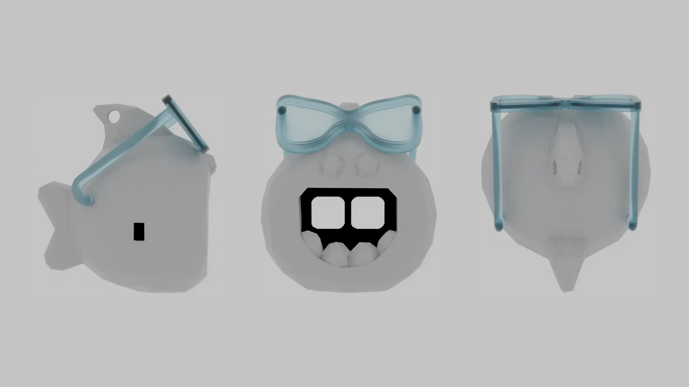

▲ 结构三视图（机身左右外壳为 3D 打印件，头顶小眼镜为市售成品迷你装饰眼镜）

---

## ✨ 功能与交互

### 1. 已上线功能与实机画面

  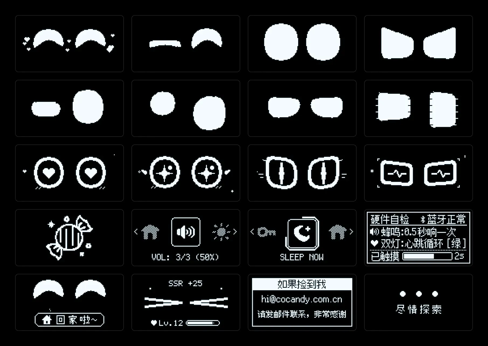

▲ 0.96" OLED (128×64) 实机部分表情、进化眼神、轮盘菜单与系统 UI 展示

- **🎭 4 套性格与触摸声光互动**：内置**元气、机敏、温柔、沉稳** 4 套性格预设，配合背部隐藏触摸、左右独立双 `WS2812B` 彩灯和贴片无源蜂鸣器给出不同情绪回应。
- **🎨 网页实时捏脸与双灯混色**：蓝牙连上网页端拖动滑块，眼睛的宽高、圆角、斜率与左右灯光配色实时同步变化。
- **📡 扫描蓝牙信号养成进化**：随身携带时被动扫描周围环境的蓝牙广播信号（可识别手机、耳机、手环及另一只 Buddy 等 32 类蓝牙图鉴）攒进糖罐，投喂升级包含**可爱治愈、灵猫幻星、几何晶核**三条路线共 12 阶瞳孔与光环形态，并逐步解锁全部 **32 种**动态表情。
- **🛡️ 环境记忆安心地点与电子防丢狗牌**：可记录「家」与最多 2 个常驻安心地点（共 3 处，如工位、工作室），在这些地点断开手机蓝牙不会误亮名牌，回到家后首次轻触还会弹出 `🏠 回家啦~` 问候；外出一旦蓝牙断连超时即切入防丢锁屏，路人轻触背部即亮屏 20 秒展示 `128×64` 像素联系名牌（支持邮箱默认生成、文字混排、二维码与手绘涂鸦）。
- **🌙 自动对时与夜间免打扰**：连接网页自动同步时间，支持调节自动息屏时长（`5 ~ 120 秒`）、4 档提示音量（静音 / 轻柔 / 适中 / 清脆）与夜间安静时段自动关灯静音。

### 2. 背部隐藏单键交互

  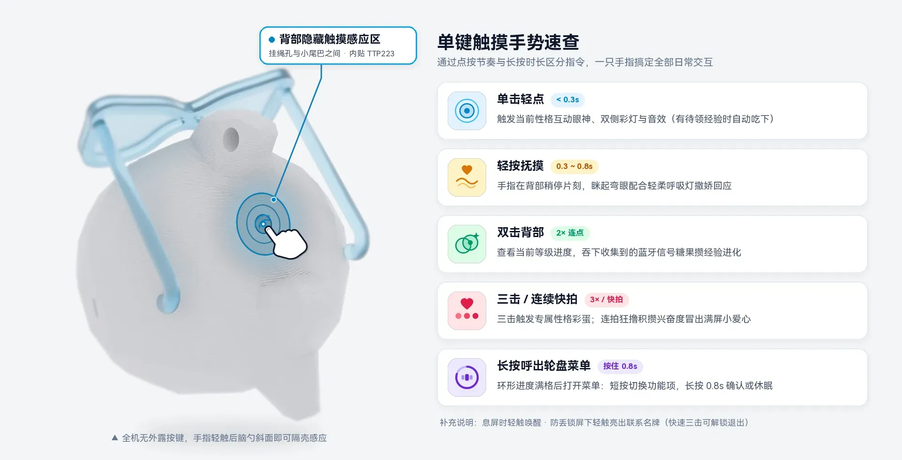

全机无外露机械按键，所有日常操作通过**挂绳孔与小尾巴之间的背部隐藏触摸区**（外壳内侧紧贴 `TTP223`）完成：

| 手势操作 | 触发效果 |
| :---: | :--- |
| **单击轻点** (`< 0.3s`) | 随机触发当前性格互动眼神、双侧彩灯与音效（有待领经验时自动吃下） |
| **轻按抚摸** (`0.3 ~ 0.8s`) | 手指在背部稍停片刻，眯起弯眼配合轻柔呼吸灯撒娇回应 |
| **双击背部** | 查看当前等级进度，吞下收集到的蓝牙广播信号攒经验升级 |
| **三击 / 连续快拍** | 三击触发专属性格彩蛋；连拍积攒兴奋度，按性格递进触发冒爱心、眯眼笑或竖眉生气等反应 |
| **长按 `0.8s`** | 呼出**横向轮盘快捷菜单**（菜单内**短按**切换功能项，**长按 `0.8s`** 环形进度条确认调节音量/亮度/性格/进化路线或立即休眠） |
| **防丢锁屏下轻触** | 亮屏 20 秒展示机主联系名牌（快速三击背部可解锁退出防丢模式） |

### 3. 正在开发（后续通过网页无线 OTA 升级）

- **🎮 单键迷你小游戏**：适配单触摸键与 `128×64` 屏幕的休闲小游戏，支持网页端在线下载更新。
- **🧭 近距蓝牙找物体**：根据蓝牙信号强度实现近距寻物与挂件声光呼唤。

---

## 🛠️ 实现思路与引脚定义

这里简要介绍这套小硬件与配套软件的实际做法；如果你想在这块开源底板上用 Arduino 或 ESP-IDF **自己写固件玩**，可以直接参考下方的引脚定义和开源表情库。

### 1. 模块叠层方案与 GPIO 引脚分配

为了控制在紧凑机身空间内且方便手工电烙铁焊接，电路没有在主板上平铺 MCU 最小系统和充电管理阻容，而是直接借用两块成品小板：
- **正面**用邮票孔平贴焊接 `ESP32-C3 SuperMini`（自带 RISC-V 主控、BLE 5.0 天线与 USB Type-C 接口），同面布置两颗 `2020 WS2812B` 彩灯、一颗驱动贴片无源蜂鸣器的 `AO3400A` N 沟道 MOS 管、侧拨电源开关，以及通过 `4P` 排针叠装的 `0.96" OLED`；
- **背面**贴焊 `TP4056` 充放保护板，`102030` 软包锂电池夹在主板与外壳后腔之间；
- **背部上方内侧斜槽**卡入 `TTP223` 电容触摸小板，隔着薄壁外壳直接感应手指触摸，省去机身按键开孔。

`ESP32-C3 SuperMini` 外设引脚与 PCB 丝印位号对应关系如下：

| 外设模块（PCB 位号） | 功能信号 | ESP32-C3 引脚 | 备注说明 |
| :--- | :--- | :---: | :--- |
| **0.96" OLED (`H1` · SSD1306)** | `I2C SDA` | `GPIO10` | 4 针 I2C 单色屏（`128×64`），对应底板 `SDA` |
| **0.96" OLED (`H1` · SSD1306)** | `I2C SCL` | `GPIO20` | 对应底板 `SCL`（排针丝印 `3V3 - GND - SCL - SDA`） |
| **TTP223 触摸模块 (`U2`)** | `TOUCH I/O` | `GPIO3` | 默认高电平有效（触摸输出高电平） |
| **左侧氛围灯 (`LED2`)** | `WS2812B DIN` | `GPIO21` | 屏幕正面视角左侧（对应 PCB 丝印 **`LED2`**，独立单总线） |
| **右侧氛围灯 (`LED1`)** | `WS2812B DIN` | `GPIO0` | 屏幕正面视角右侧（对应 PCB 丝印 **`LED1`**，独立单总线非级联） |
| **贴片无源蜂鸣器 (`BUZ1`)** | `PWM 驱动` | `GPIO1` | 经 `AO3400A` (`Q2`) NMOS 驱动，谐振约 `2.7 kHz` |

### 2. 参数化实时画眼与开源表情库 `Bit-Eye-Lib`

`SSD1306` 单色屏整帧显存只有 `128 × 64 = 1024 Bytes`（1 KB）。如果采用传统预渲染序列帧图片，不仅很快占满 Flash，也没法自由调整眼型。

因此，设备端眼睛全部采用**几何参数实时绘制**：把左右眼拆解为宽高、偏移量、上下眼睑斜率、上下圆角半径等 8 个参数，每帧由代码实时光栅化生成眨眼、视线移动、按压形变与情绪过渡，再叠加各进化分支的瞳孔与光环像素图案。网页端“实时捏脸”拖动滑块时，蓝牙每次只需传输 8 字节眼型参数即可立即生效。

> 💡 **想自己写固件画表情？**  
> 我们单独开源了一套纯 C++ 跨平台参数化表情眼睛渲染库 👉 **[ByCoCandy/Bit-Eye-Lib](https://github.com/ByCoCandy/Bit-Eye-Lib)**。  
> 它不依赖特定硬件平台，只需实现 `IDisplay` 的 6 个基础绘图方法（`SetColor`、`DrawHLine`、`FillRect`、`FillTriangle`、`Clear`、`Flush`）即可在 `128×64` OLED、TFT 或 PC 窗口上跑起 18 种平滑过渡的动态眼神，非常适合直接拿来给 Buddy 硬件编写自定义固件。

### 3. 蓝牙广播采集与点阵名牌存储

- **蓝牙信号化糖**：日常待机间隙开启低占空比 BLE 被动扫描，对周围环境中的蓝牙广播设备做去重与图鉴分类计数，折算成待领取的经验糖果，无需手机 App 常驻后台运行。
- **防丢名牌位图预排版**：MCU 本地不塞庞大的中文字库文件；联系名牌在网页端利用内置点阵字库、二维码生成器或手绘画布，直接在浏览器里渲染成一张标准的 `128×64` 单色位图（恰好 `1024 Bytes`），经蓝牙下发写入设备 Flash，断连超时进入防丢状态后直接读取上屏。

### 4. 纯前端免客户端工具链（WebSerial + WebBLE）

配套工具全部运行在浏览器内，无需安装手机 App 或电脑串口烧录软件：
- **首次有线刷机**：通过浏览器原生 **WebSerial API** 直连 `ESP32-C3` 内置 USB Serial/JTAG 接口写入固件；
- **日常连接与无线升级**：通过 **WebBluetooth (WebBLE)** GATT 服务完成实时调参、点阵名牌下发与双分区无线 OTA 固件升级。

---

## 📱 开放网页端

打开 **[home.cocandy.com.cn](https://home.cocandy.com.cn)** 即可连接设备，电脑、安卓、iOS 均可使用：

| 使用设备 | 推荐浏览器 | 支持能力说明 |
| :---: | :---: | :--- |
| **💻 电脑 (Windows / macOS)** | `Chrome` / `Edge` | 蓝牙直连全功能调参 + 无线 OTA + **USB 串口一键有线刷机** |
| **🤖 安卓 (Android)** | `Chrome` / `Edge` | 蓝牙直连全功能调参（捏脸、投喂、画名牌、无线 OTA） |
| **🍎 苹果 (iOS / iPadOS)** | **`Bluetooth Browser`** | 在 App Store 下载 **Bluetooth Browser** 后输入网址即可蓝牙直连（自带 Safari 不支持 WebBLE） |

<table align="center" width="100%">
  <tr align="center">
    <td width="33%">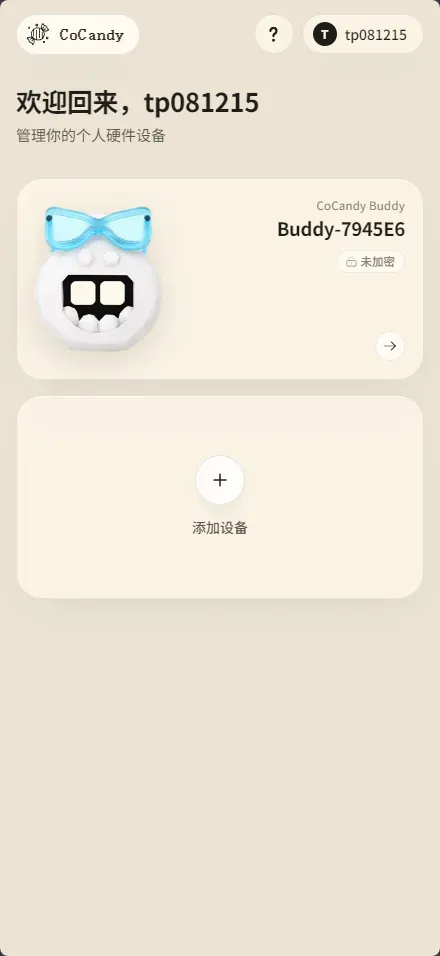</td>
    <td width="33%">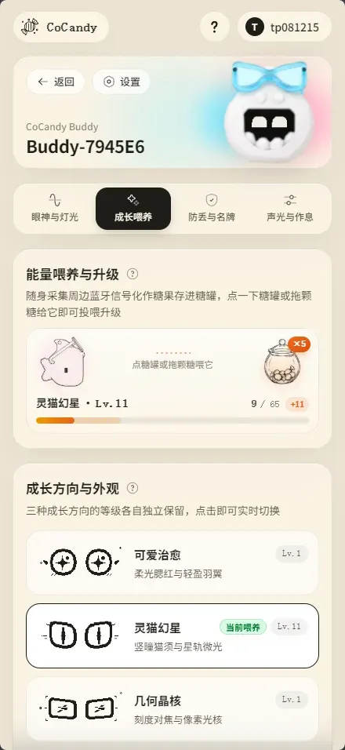</td>
    <td width="33%">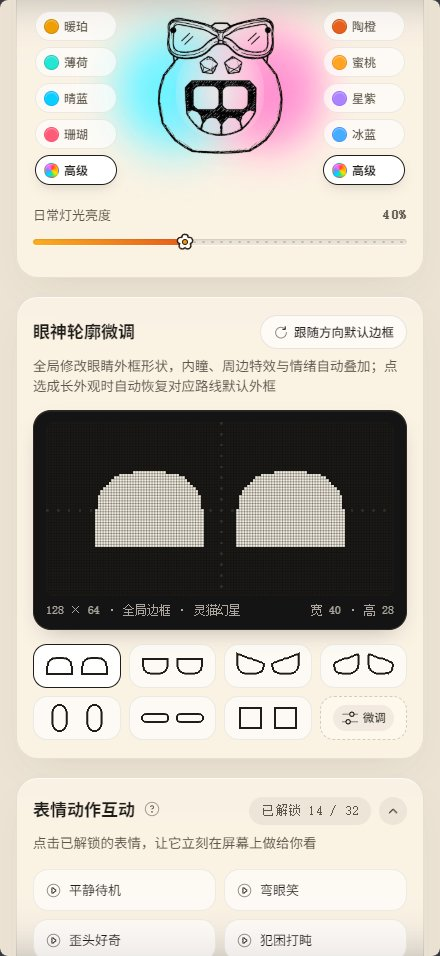</td>
  </tr>
  <tr align="center">
    <td><b>设备管理主页</b> 蓝牙直连与多设备管理</td>
    <td><b>成长喂养</b> 蓝牙信号糖罐投喂与三路线进化</td>
    <td><b>眼神与灯光 DIY</b> 双灯独立配色、128×64 捏脸与表情点播</td>
  </tr>
</table>

---

## 🧩 硬件清单与打印

  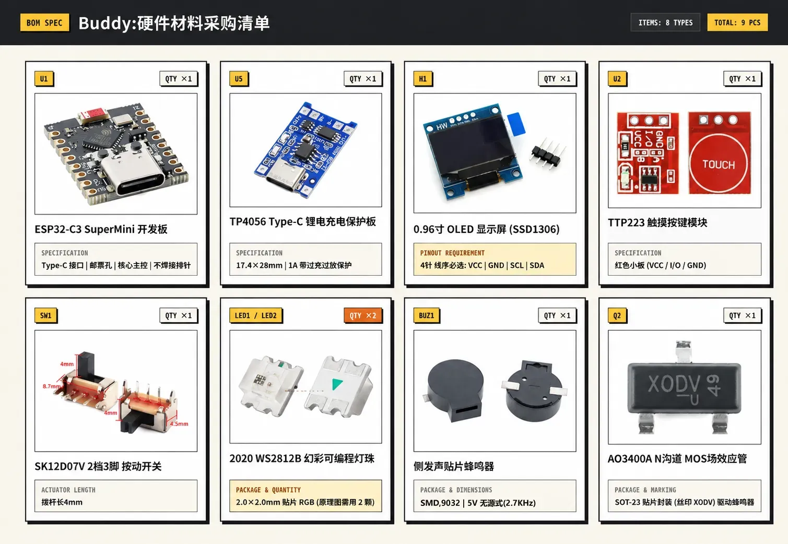

### 1. 电路元器件清单（8 种共 9 个）

使用仓库 `PCB/` 目录内的 Gerber 制板包（或 `.epro2` 工程）打样双层 PCB 底板，另备一块 `3.7V` `102030` 软包锂电池与以下常见器件：

| 位号 | 器件名称 | 数量 | 选型规格与购买提醒 |
| :---: | :--- | :---: | :--- |
| **U1** | ESP32-C3 SuperMini 开发板 | `1` | Type-C 接口，邮票孔直接平贴焊在底板上，**不要焊排针** |
| **U5** | TP4056 Type-C 锂电充电保护板 | `1` | 带 `B+ / B- / OUT+ / OUT-` 焊盘与过充过放保护（对照采购图选常见标准款） |
| **H1** | 0.96 寸 OLED 显示屏 (SSD1306) | `1` | 4 针 I2C 单色屏（配 `1×4P 2.54mm` 排针焊接），**买前务必核对线序：`VCC - GND - SCL - SDA`** |
| **U2** | TTP223 触摸按键模块 | `1` | 常见红色电容触摸小板（`VCC / I/O / GND`） |
| **SW1** | SK12D07V 系列 2档3脚 侧拨开关 | `1` | 卧式弯脚插件（工程封装为 `SK12D07VG5`，同封装 `VG4` 等亦可；焊时尽量往板内靠紧） |
| **LED1, LED2** | 2020 WS2812B 幻彩 RGB 灯珠 | `2` | `SMD 2020` 贴片封装（如 `WS2812B-2020`，体积小建议多备两颗） |
| **BUZ1** | 侧发声贴片无源蜂鸣器 | `1` | 贴片电磁式无源蜂鸣器，谐振约 `2.7 kHz`（工程型号 `HYG-9025A`，同焊盘兼容 `SMD9032` 侧发声款） |
| **Q2** | AO3400A N沟道 MOS 管 | `1` | `SOT-23` 贴片封装（实物常见丝印 `A10T` / `X0DV`），用于驱动蜂鸣器 |

### 2. 电池、外壳打印与装饰眼镜说明

- 🔋 **软包锂电池**：使用型号 **`102030`** 的 `3.7V` 带保护板软包锂电池（下方左图实拍为 `650mAh`，买时认准 `102030` 规格，偏大将无法合上外壳）。
- 🖨️ **3D 打印机身外壳**：使用仓库 `Model/step/` 目录中的 `left.stp`、`right.stp` 左右半壳文件直接切片打印即可（常规 PLA / PETG 等耗材均可）。
- 👓 **装饰小眼镜（淘宝识图购买）**：头顶的半透小眼镜**不是打印件**，直接保存下方右图打开**淘宝拍照识图（拍立淘）**即可搜到同款成品迷你小眼镜。

<table align="center" width="84%">
  <tr align="center">
    <td width="46%">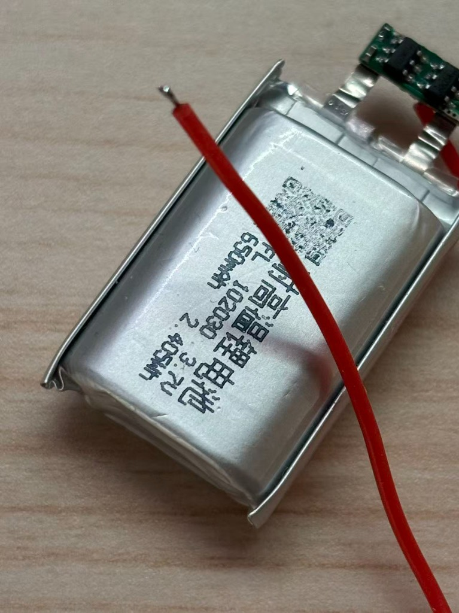</td>
    <td width="54%">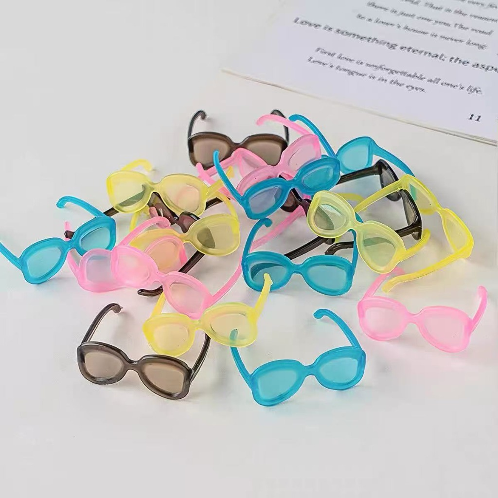</td>
  </tr>
  <tr align="center">
    <td><b>▲ 电池参考</b>：型号 <code>102030</code> (3.7V 650mAh 带保护板软包锂电)</td>
    <td><b>▲ 小眼镜参考</b>：保存此图用淘宝“拍立淘”识图购买同款</td>
  </tr>
</table>

---

## 🔧 焊接组装与刷机

  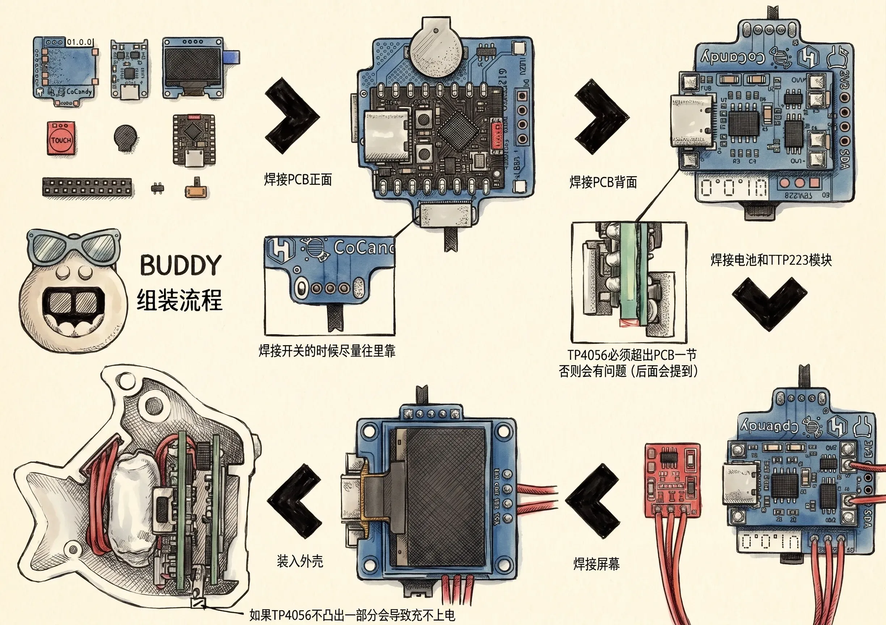

▲ 焊接与装壳完整流程

> ⚠️ **装机前必看：2 个结构避坑重点**
> - **避坑 1（开关往里靠）**：焊正面 `SK12D07V` 拨动开关时**尽量往 PCB 内侧靠紧**，留出合适的拨杆外露长度，防止装壳时顶住外壳。
> - **避坑 2（充电口往外探）**：背面 `TP4056` 带 Type-C 口的一端**必须超出 PCB 边缘一小节**（参照上图特写）！如果焊平齐或缩在板内，装壳后充电线插头会被外壳挡住插不到底。

1. **焊正面贴片与主控**：依次焊好 2 颗 `2020 WS2812B` 灯珠、`AO3400A` MOS 管、侧发声蜂鸣器、`ESP32-C3 SuperMini`（邮票孔平贴上锡）以及侧拨开关。
2. **焊背面 TP4056 充电板**：将 `TP4056` 模块按“Type-C 口略微外探”的位置贴焊在主板背面对应焊盘上。
3. **接好触摸板、电池与屏幕**：用细软硅胶线焊接 `TTP223` 触摸模块（装壳时卡在背部上方内侧斜槽里）和锂电池正负极，再通过 `4P` 排针将 `0.96 寸 OLED` 焊到主板 `3V3 / GND / SCL / SDA`。
4. **先通电、再合壳**：合盖前先拨动开关通电测试，确认点亮正常后把 `102030` 电池夹在中间理顺导线，扣合左右外壳、架上小眼镜即可。

### 在线一键烧录与硬件自检

  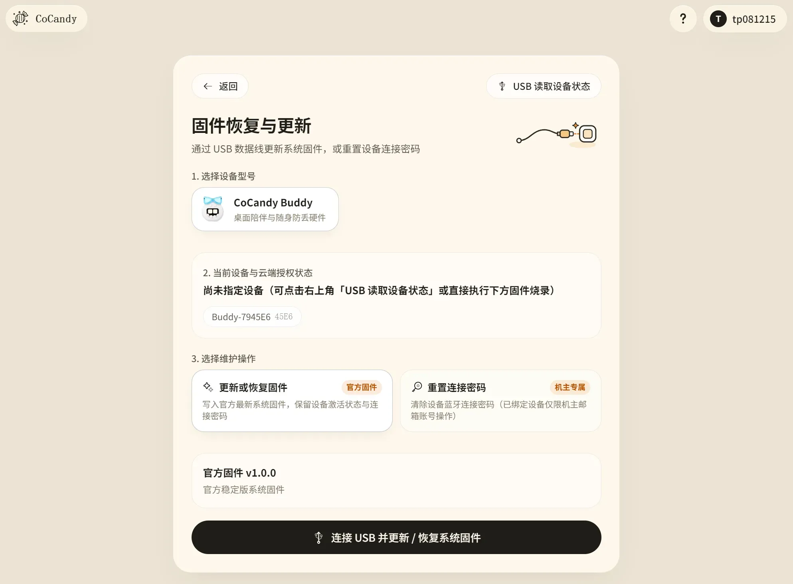

> ⚡ **USB 插线前必看（对应 PCB 正面丝印提示）**：  
> 若已焊接锂电池，**用数据线连接内部 `ESP32-C3` 的 Type-C 口供电或刷机前，务必先将侧边电源开关拨至「关」**，防止 USB `5V` 倒灌至电池供电端！日常充电请插外壳底部露出的 `TP4056` Type-C 口。

1. **网页有线首刷**：使用电脑 `Chrome` / `Edge` 打开 👉 **[https://home.cocandy.com.cn/flash](https://home.cocandy.com.cn/flash)**，确认侧边开关处于**关闭**状态后，将数据线插在**内部 `ESP32-C3` 的 Type-C 口**上（背面 `TP4056` 的口仅充电不走数据；若未识别可按住 `BOOT` 键再插线），选中 Buddy 一键烧录。
2. **5 秒自检与单机激活**：首次开机自带**免费装机自检引导**，确认蜂鸣器、双灯与触摸均正常（焊接无误）后，按屏幕提示**长按背部触摸区 5 秒**完成自检；随后打开 **[home.cocandy.com.cn](https://home.cocandy.com.cn)** 连接蓝牙 `Buddy-XXXXXX`，使用在 **[商店](https://store.cocandy.com.cn)** 获取的激活码完成单机绑定（绑定芯片硬件 ID，重刷不丢），即可解锁全部自定义与后续无线 OTA 功能。

<table align="center" width="100%">
  <tr align="center">
    <td width="50%">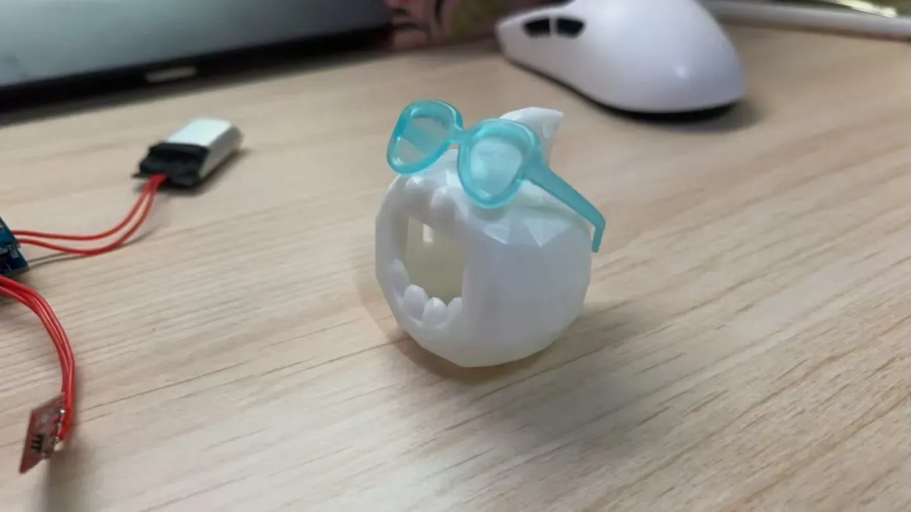</td>
    <td width="50%">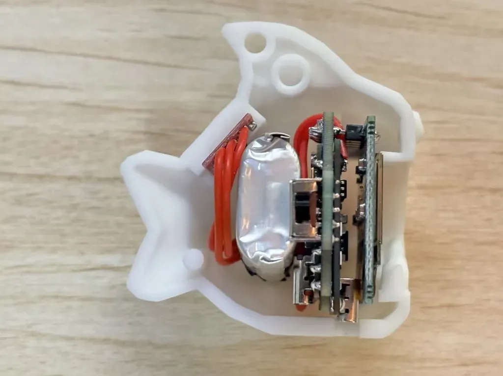</td>
  </tr>
  <tr align="center">
    <td><b>▲ 塞进去之前</b>：桌面试装空壳与初代圆框小眼镜</td>
    <td><b>▲ 塞满之后</b>：从左到右依次卡入触摸片、软包电池、主板叠层与 OLED 屏</td>
  </tr>
</table>

---

## 🎨 二创与折腾指南

本仓库同时提供了可直接制板的 PCB 工程（`.epro2` / Gerber）、可直接打印的 `.stp` 实体，以及完整的 **Rhino (`.3dm`) 建模源文件**与 **Blender (`.blend`) 渲染工程**，留足了改装空间，欢迎按自己的想法随便折腾：

### 1. 结构外观与周边配件二创
- **拓展形态配件**：基于外壳 `.3dm` / `.stp` 模型，可以很容易地衍生设计出**桌面磁吸底座**、**显示器顶部挂架**、**书包肩带快拆背夹**或**车载出风口卡扣**。
- **换装与造型魔改**：修改头顶与背部特征面，比如把小尾巴改成猫耳、恶魔角、发条钥匙，或者定制不同框型的可替换配件。
- **耗材与透光玩法**：机身内部左右两侧各有一颗高亮 `2020 WS2812B` 彩灯——除了常规白色 PLA，非常推荐试试**半透明 PETG / 透明光敏树脂 / 夜光或温变耗材**打印外壳，让内部呼吸彩灯直接透壳漫反射出来，或是用丙烯颜料给低多边形折面手涂撞色。

### 2. 自研开源固件折腾（当成掌上迷你开发板玩）
去掉官方固件限制看本质，这块板子就是一套自带**锂电充放管理 + `128×64 OLED` + 左右双路 RGB 灯 + 电容触摸键 + 无源蜂鸣器 + `ESP32-C3`（Wi-Fi & BLE 5.0）** 的超袖珍掌上开发终端。

对照上文的 **GPIO 引脚分配表**，你可以直接用 **Arduino / PlatformIO / ESP-IDF** 从零写自己的固件，搭配我们开源的 **[Bit-Eye-Lib](https://github.com/ByCoCandy/Bit-Eye-Lib)** 表情渲染库，能轻松改出很多有意思的小玩意：
- **🍅 桌面番茄钟 / 久坐提醒器**：摸一下后背开启 25 分钟专注倒计时，到点双灯呼吸闪烁 + 蜂鸣器提醒。
- **📊 Wi-Fi 迷你状态监视屏**：利用 `ESP32-C3` 自带的 2.4GHz Wi-Fi 拉取天气、GitHub Star 数、B 站粉丝数或家用服务器在线状态。
- **⌨️ 蓝牙无线小宏键（BLE HID）**：模拟蓝牙键盘/多媒体键，放在手边摸一下一键静音麦克风、切歌或锁屏。
- **🕹️ 单键像素小游戏机**：在 `128×64` 屏幕上跑自己写的 Flappy Bird、小恐龙跳仙人掌或电子木鱼。

如果你做出了好玩的外壳改件或自研开源固件，欢迎提 Issue / PR 贴出你的仓库链接，我们可以直接收录展示在 README 里！

---

## 🤝 社区与许可证

### 🔄 持续更新与维护
- **玩法与固件持续上新**：正在开发中的**单键迷你小游戏**、**蓝牙近距寻物**，以及更多性格小动作、表情包与网页端新功能会陆续推送。
- **现有硬件免拆壳 OTA**：焊好的机器无需改板或拆壳插线，后续有新固件时直接在 **[home.cocandy.com.cn](https://home.cocandy.com.cn)** 连上蓝牙即可无线升级。

### 💬 交流反馈
- **🐧 QQ 交流群**：**`1042593321`**（复刻答疑、拼单交流、固件更新通知、晒图吹水欢迎进群）
- **🐛 问题与建议**：遇到任何硬件/模型细节问题，或有新功能点子，欢迎直接在仓库提交 **[Issue](https://github.com/ByCoCandy/buddy/issues)**。
- **⭐ 支持项目**：觉得这只小挂件好玩的话，欢迎右上角点个 **Star ⭐** 支持一下！

### 📄 许可证与售卖说明
- **基础开源协议**：本仓库内的电路原理图、PCB 制板文件、3D 外壳模型与图文文档默认采用 **[CC BY-NC-SA 4.0](LICENSE)**（署名-非商业性使用-相同方式共享 4.0 国际）协议开源，欢迎个人 DIY 复刻与非商业二创分享（也可配合开源 **[Bit-Eye-Lib](https://github.com/ByCoCandy/Bit-Eye-Lib)** 自行编写固件免费使用）。
- **官方固件单机激活**：官方预编译固件与在线网页服务闭源并保留全部权利。**[home.cocandy.com.cn/flash](https://home.cocandy.com.cn/flash)** 免费开放 USB 一键刷机与 5 秒装机硬件自检；解锁完整养成系统、网页实时捏脸与终身无线 OTA 升级采用**单机激活制**（第 1 台起按单机在 **[store.cocandy.com.cn](https://store.cocandy.com.cn)** 购买激活码，一机一码永久绑定芯片硬件 ID，重刷固件无需重复购码）。
- **散料包与成品售卖许可（绑定官方固件生态）**：**允许个人或第三方店铺售卖 DIY 散件物料包、3D 打印外壳及组装好的 BUDDY 成品**——商品页须醒目标注 `BUDDY · CoCandy` 原作署名；组装成品须烧录官方正版固件并完成单机激活后交付，散件包须向买家如实说明官方固件需单机激活（或自写开源固件）。**严禁将本项目的 3D 外壳、PCB 设计或其衍生外观搭载任何非官方（第三方/自改）固件进行商业售卖**。非官方直营渠道售出的散件或成品，其器件品质、焊接做工、电池安全与退换货售后均由对应卖家自行负责，官方仅提供在线网页与固件更新支持。详见 [LICENSE](LICENSE)。

---

  

  <a href="https://cocandy.com.cn" target="_blank">CoCandy 官网</a> &nbsp;·&nbsp;
  <a href="https://home.cocandy.com.cn" target="_blank">设备中心</a> &nbsp;·&nbsp;
  <a href="https://store.cocandy.com.cn" target="_blank">商店主页</a> &nbsp;·&nbsp;
  <a href="https://home.cocandy.com.cn/flash" target="_blank">烧录平台</a> &nbsp;·&nbsp;
  <a href="https://github.com/ByCoCandy/Bit-Eye-Lib" target="_blank">Bit-Eye-Lib</a>

