

  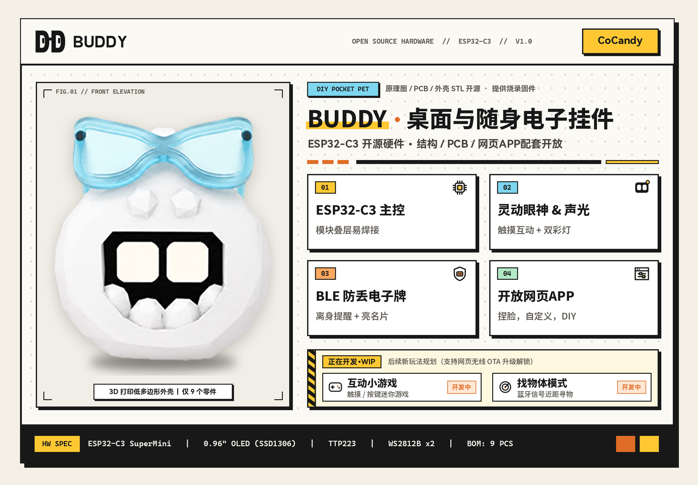

<h1 align="center">BUDDY</h1>

<b>An ESP32-C3 open-source desk &amp; pocket pet pendant: capacitive touch reactions, BLE signal feeding, anti-lost pixel dogtag, and browser-based face customization.</b>

  <a href="#-overview">Overview</a> &nbsp;|&nbsp;
  <a href="#-features--interaction">Features</a> &nbsp;|&nbsp;
  <a href="#-implementation--pinout">Implementation &amp; Pinout</a> &nbsp;|&nbsp;
  <a href="#-web-app">Web App</a> &nbsp;|&nbsp;
  <a href="#-bill-of-materials--3d-printing">BOM &amp; Printing</a> &nbsp;|&nbsp;
  <a href="#-assembly--flashing">Assembly &amp; Flashing</a> &nbsp;|&nbsp;
  <a href="#-modding--custom-firmware">Modding</a> &nbsp;|&nbsp;
  <a href="#-community--license">Community &amp; License</a>

<a href="README.md"><b>中文</b></a>

  
  
  
  
  

---

## 📖 Overview

**BUDDY** is a low-poly electronic pendant built around the **ESP32-C3 SuperMini**. Sitting on your desk, it blinks, plays chiptune melodies, and lights up dual RGB LEDs when you pet its back—and gets grumpy if you spam-tap it too fast. Clipped onto a backpack or keychain, it passively collects nearby Bluetooth broadcasts as "candy" to level up and evolve; if you accidentally leave your bag behind, anyone who taps its back can view your `128×64` pixel contact dogtag.

Instead of fine-pitch bare QFN chips and dozens of passives, the hardware uses a **custom 2-layer carrier PCB + off-the-shelf module stack**—totaling just **8 component types (9 parts in all)**, easily soldered with a standard soldering iron.

- **Open-Source Hardware & Enclosure**: Schematics, EasyEDA Pro PCB project (`.epro2`) & Gerber files, 3D-printable shell models (`.stp` / `.3dm` / `.blend`), GPIO pinout, and documentation are released under `CC BY-NC-SA 4.0` (you can also write your own free custom firmware using **[Bit-Eye-Lib](https://github.com/ByCoCandy/Bit-Eye-Lib)**).
- **Companion Firmware & Web App**: Official precompiled firmware (closed-source) provides **free 1-click USB flashing & 5-second hardware soldering self-test** at **[home.cocandy.com.cn/flash](https://home.cocandy.com.cn/flash)**; unlocking the full pet system, live BLE customization (**[home.cocandy.com.cn](https://home.cocandy.com.cn)**), and lifetime wireless OTA updates uses **per-device activation** from the 1st unit via **[store.cocandy.com.cn](https://store.cocandy.com.cn)** (1 code per device, permanently bound to chip hardware ID across reflashes).
- **DIY Kits & Finished Units**: Selling DIY component kits, 3D-printed shells, and pre-activated assembled units running official firmware **is permitted** (with `BUDDY · CoCandy` attribution and clear activation disclosure); **selling this project's enclosure or PCB design with any third-party/modified firmware is strictly prohibited**.

  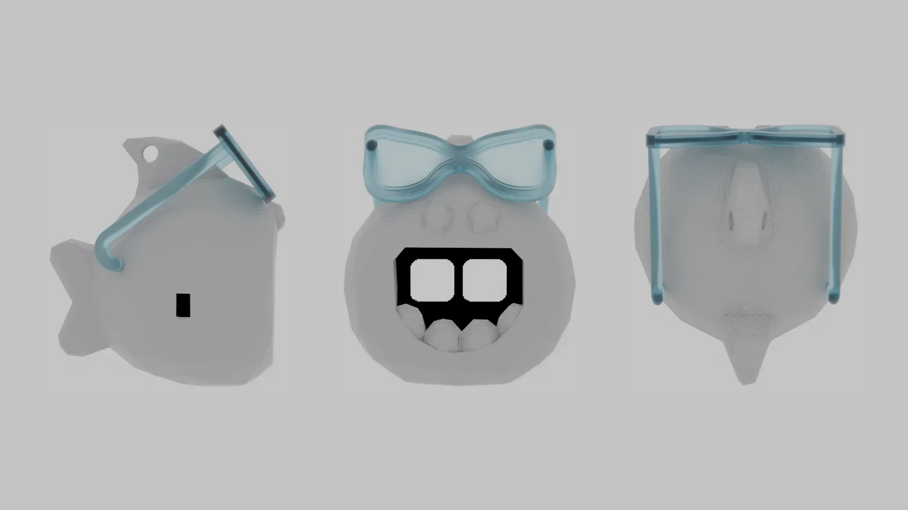

▲ Orthographic views (left &amp; right shell halves are 3D-printed; the mini glasses are off-the-shelf accessories)

---

## ✨ Features & Interaction

### 1. Live Features & On-Device UI

  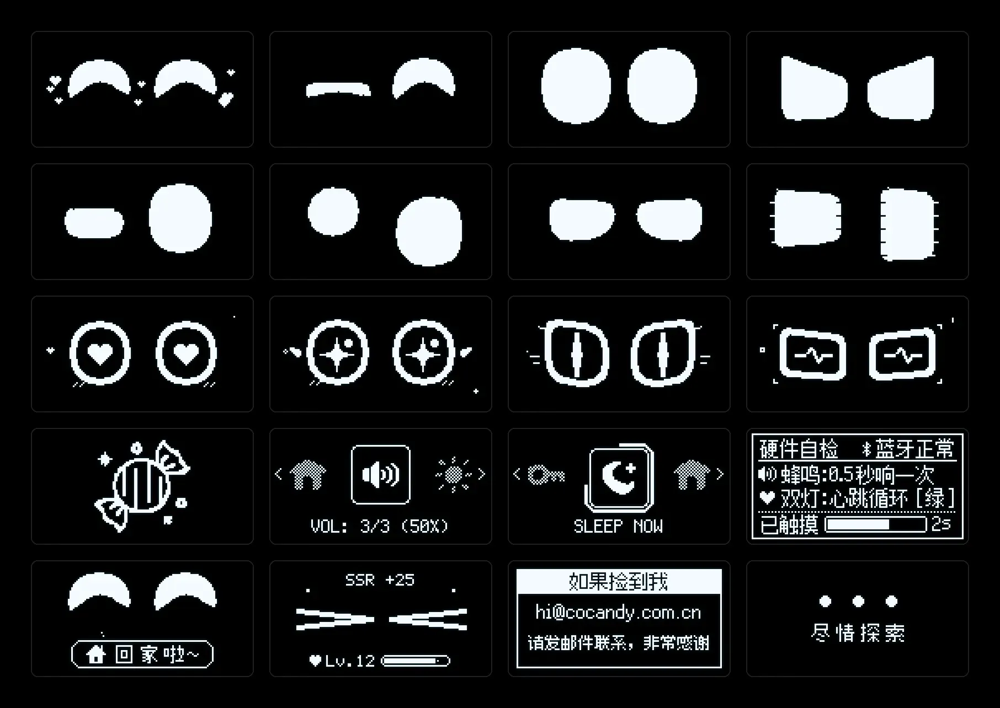

▲ Sample expressions, evolution eyes, wheel menu, and system UI captured from the 0.96" OLED (128×64)

- **🎭 4 Personalities & Touch/Light/Sound Feedback**: Built-in **Cheerful, Alert, Gentle, and Calm** (`CHEERFUL / FIERCE / TIMID / STOIC`) persona presets, paired with a hidden rear capacitive touch pad, dual independent `WS2812B` RGB LEDs, and a passive SMD buzzer.
- **🎨 Real-Time Face Sculpting & Dual-LED Mixing**: Drag sliders in the browser over BLE to tweak eye width, height, corner radius, eyelid slopes, and independent left/right LED colors in real time.
- **📡 BLE Signal Feeding & Evolution**: Passively scans ambient BLE advertisements on the go (classifying 32 signal species from phones and earbuds to wild Buddies) and stores them in a candy jar. Feeding unlocks **3 evolution paths** (*Cute Healing*, *Mystic Neko*, *Geo Core*) across 12 pupil/aura tiers and **32** dynamic expressions.
- **🛡️ Environment-Memory Safe Zones & Anti-Lost Dogtag**: Memorizes **Home** plus up to 2 frequent safe places (3 slots total, e.g., desk or studio) so disconnecting your phone indoors never triggers a false alarm, and touching Buddy after returning home shows a `🏠 Welcome Home` greeting. When out and disconnected past timeout, it locks into Lost Dogtag mode—tapping the back wakes the screen for 20s to show your `128×64` contact card (email default, formatted text, QR code, or freehand pixel art).
- **🌙 Auto Time Sync & Night Do-Not-Disturb**: Automatically syncs time upon connecting to the web app, with configurable auto-sleep (`5 ~ 120s`), 4-step volume (Mute / Soft / Medium / Crisp), and scheduled night quiet hours.

### 2. Hidden Rear Single-Key Gestures

  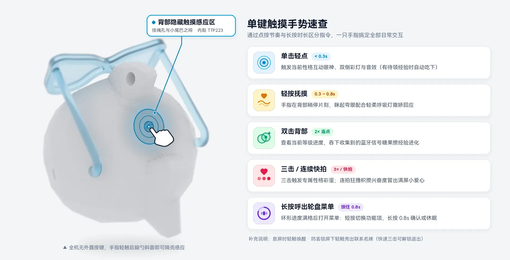

There are no exposed mechanical buttons—all daily interactions happen on the **sloped upper-back surface between the lanyard lug and the tail** (with a `TTP223` pad slotted flush inside the shell):

| Gesture | Action |
| :---: | :--- |
| **Single Tap** (`< 0.3s`) | Triggers persona eye reaction, dual-LED effect, and melody (auto-claims pending EXP if available) |
| **Gentle Stroke** (`0.3 ~ 0.8s`) | Rest finger briefly on the back for a happy squinted-eye &amp; breathing-light response |
| **Double Tap** | Checks current level progress and feeds collected BLE signal candies to evolve |
| **Triple Tap / Rapid Petting** | Triple tap triggers persona easter egg; rapid taps build excitement into persona-specific tiered reactions (hearts, squints, or fierce glare) |
| **Long Press `0.8s`** | Opens the **horizontal wheel menu** (**short tap** cycles items; **hold `0.8s`** progress ring adjusts volume/brightness/persona/evolution branch or sleeps) |
| **Tap on Lost Lockscreen** | Wakes screen for 20s to display owner's pixel contact dogtag (fast triple tap on back unlocks Lost mode) |

### 3. In Development (Delivered via Wireless Web OTA)

- **🎮 Single-Key Mini Games**: Casual `128×64` mini games tailored for one-touch control, downloadable via WebBLE.
- **🧭 Proximity BLE Finder**: Nearby item radar and audio-visual ping based on Bluetooth RSSI.

---

## 🛠️ Implementation & Pinout

Below is a concise overview of how the hardware and software are put together. If you want to **write your own custom firmware** on this board using Arduino or ESP-IDF, the complete pin mapping and our standalone open-source eye library are right below.

### 1. Stacked Module Layout & GPIO Pinout

To fit inside the compact low-poly head while keeping hand-soldering beginner-friendly, the carrier PCB delegates RF/USB and battery management to two ready-made modules:
- **Front side**: Castellated `ESP32-C3 SuperMini` soldered flat onto the carrier board alongside two `2020 WS2812B` LEDs, an `AO3400A` NMOS driving the side-firing passive buzzer, a slide power switch, and the `0.96" OLED` stacked via a `4P` pin header;
- **Back side**: `TP4056` LiPo charger/protection board, with a `102030` pouch cell tucked between the PCB stack and the rear shell;
- **Inner upper-back slot**: `TTP223` capacitive touch board sensing finger touches directly through the thin shell wall without exterior holes.

`ESP32-C3 SuperMini` peripheral pin assignment and PCB silkscreen designators:

| Peripheral (PCB Ref) | Signal | ESP32-C3 GPIO | Notes |
| :--- | :--- | :---: | :--- |
| **0.96" OLED (`H1` · SSD1306)** | `I2C SDA` | `GPIO10` | 4-pin I2C monochrome display (`128×64`), header pin `SDA` |
| **0.96" OLED (`H1` · SSD1306)** | `I2C SCL` | `GPIO20` | Header pin `SCL` (silkscreen order: `3V3 - GND - SCL - SDA`) |
| **TTP223 Touch Sensor (`U2`)** | `TOUCH I/O` | `GPIO3` | Active-HIGH digital input |
| **Left RGB LED (`LED2`)** | `WS2812B DIN` | `GPIO21` | Left side from front screen view (PCB silkscreen **`LED2`**, dedicated channel) |
| **Right RGB LED (`LED1`)** | `WS2812B DIN` | `GPIO0` | Right side from front screen view (PCB silkscreen **`LED1`**, not daisy-chained) |
| **Passive Buzzer (`BUZ1`)** | `PWM Drive` | `GPIO1` | Driven via `AO3400A` (`Q2`) NMOS (~`2.7 kHz` resonant) |

### 2. Parametric Real-Time Eye Rendering & `Bit-Eye-Lib`

A `128×64` monochrome framebuffer occupies just `1024 Bytes` (1 KB). Rather than storing pre-rendered bitmap sprite sheets in Flash, the eyes are rasterized in real time from 8 geometric parameters—width, height, X/Y offset, top/bottom eyelid slopes, and top/bottom corner radii—combined with blink compression, gaze saccades, and evolution pupil/aura overlays. Adjusting face sliders in the web app simply sends 8 bytes of shape parameters over BLE.

> 💡 **Writing your own firmware?**  
> Check out our standalone, platform-independent C++ parametric eye library: 👉 **[ByCoCandy/Bit-Eye-Lib](https://github.com/ByCoCandy/Bit-Eye-Lib)**.  
> Its core has zero hardware dependencies—implement just 6 `IDisplay` methods (`SetColor`, `DrawHLine`, `FillRect`, `FillTriangle`, `Clear`, `Flush`) to run 18 smooth animated emotions on a `128×64` OLED, TFT, or desktop window.

### 3. BLE Broadcast Sniffing & 1-Bit Dogtag Bitmap

- **BLE Broadcast Feeding**: During idle intervals, low-duty passive BLE scans deduplicate and classify nearby advertising packets into claimable EXP without requiring a background phone app.
- **Pre-Rasterized Dogtag**: Instead of bundling large CJK font tables on the MCU, the browser renders formatted text, QR codes, or freehand drawings into a raw `128×64` 1-bit bitmap (`1024 Bytes`) and writes it to device Flash over BLE.

### 4. Browser-Only Toolchain (WebSerial + WebBLE)

No native mobile apps or desktop UART flashers are required:
- **Initial USB Flashing**: Uses the browser's **WebSerial API** over the `ESP32-C3` built-in USB Serial/JTAG interface;
- **Daily Control & Wireless OTA**: Uses **WebBluetooth (WebBLE)** GATT characteristics for live tuning, dogtag sync, and dual-partition wireless OTA firmware updates.

---

## 📱 Web App

Open **[home.cocandy.com.cn](https://home.cocandy.com.cn)** on desktop, Android, or iOS:

| Platform | Recommended Browser | Capabilities |
| :---: | :---: | :--- |
| **💻 Desktop (Windows / macOS)** | `Chrome` / `Edge` | Full WebBLE configuration + Wireless OTA + **1-Click USB Flashing (`WebSerial`)** |
| **🤖 Android** | `Chrome` / `Edge` | Full WebBLE configuration (face sculpting, feeding, dogtag editor, Wireless OTA) |
| **🍎 iOS / iPadOS** | **`Bluetooth Browser`** | Install **Bluetooth Browser** from the App Store and open the URL (system Safari lacks WebBLE) |

<table align="center" width="100%">
  <tr align="center">
    <td width="33%">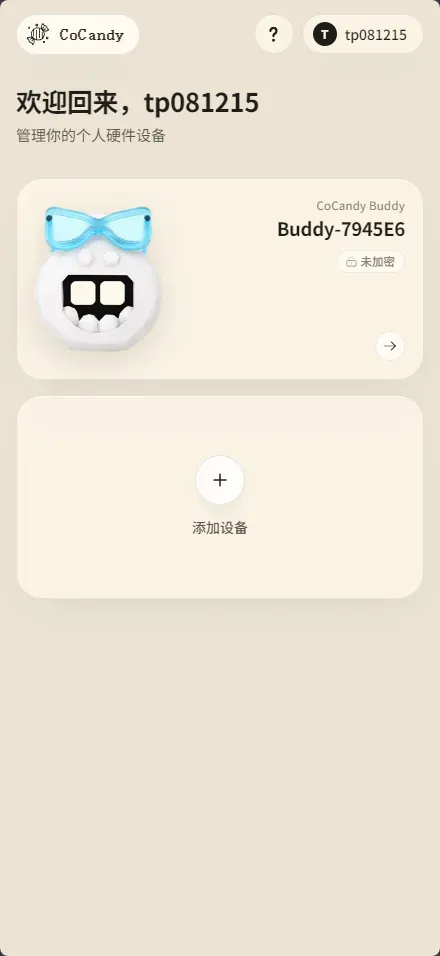</td>
    <td width="33%">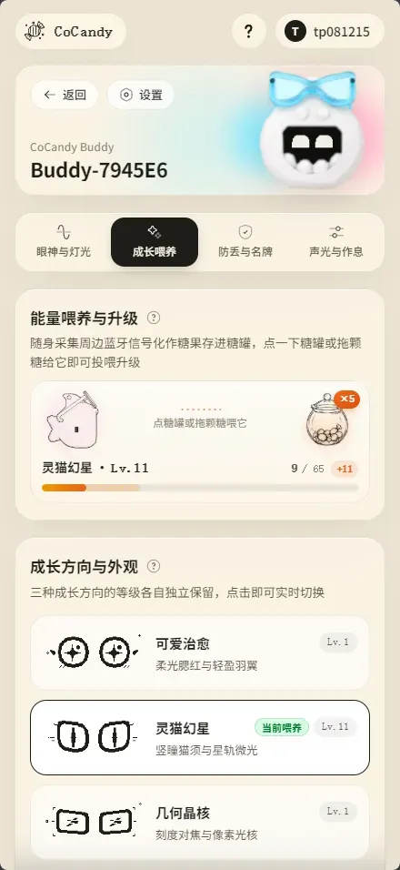</td>
    <td width="33%">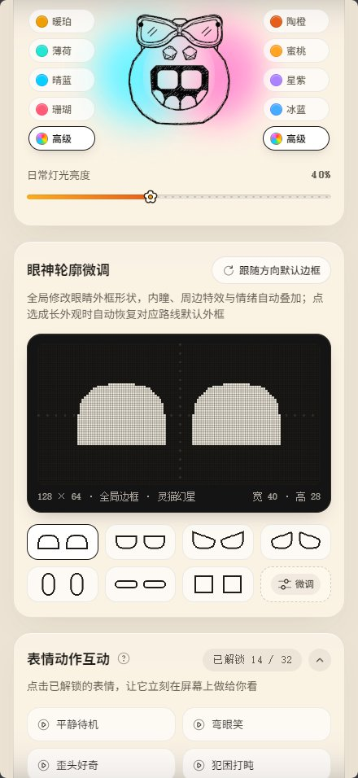</td>
  </tr>
  <tr align="center">
    <td><b>Device Hub</b> BLE connection &amp; multi-device management</td>
    <td><b>Growth &amp; Feeding</b> BLE candy jar &amp; 3 evolution branches</td>
    <td><b>Eyes &amp; LED Studio</b> Dual-LED colors, 128×64 face sculpting &amp; emotes</td>
  </tr>
</table>

---

## 🧩 Bill of Materials & 3D Printing

  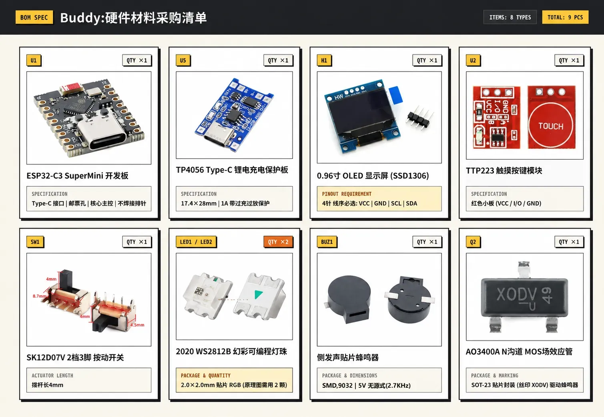

### 1. Electronic Components (8 Types, 9 Parts Total)

Fabricate the 2-layer carrier PCB using the Gerber archive (or `.epro2` project) in `PCB/`, and gather one `3.7V` `102030` LiPo pouch battery plus the following parts:

| Ref | Component | Qty | Specification & Buying Notes |
| :---: | :--- | :---: | :--- |
| **U1** | ESP32-C3 SuperMini Board | `1` | USB Type-C; solder castellated pads flat onto the PCB (**do not solder pin headers**) |
| **U5** | TP4056 Type-C LiPo Charger Module | `1` | Standard 6-pad board (`B+ / B- / OUT+ / OUT-`) with over-charge/discharge protection (match BOM photo) |
| **H1** | 0.96" OLED Display (SSD1306) | `1` | 4-pin I2C monochrome display (mounted via `1×4P 2.54mm` header); **verify pin order: `VCC - GND - SCL - SDA`** |
| **U2** | TTP223 Capacitive Touch Module | `1` | Common red breakout board (`VCC / I/O / GND`) |
| **SW1** | SK12D07V Series SPDT Slide Switch | `1` | Right-angle side-actuated (PCB footprint `SK12D07VG5`, compatible with `VG4`; seat inward when soldering) |
| **LED1, LED2** | 2020 WS2812B Addressable RGB LED | `2` | `SMD 2020` package (e.g., `WS2812B-2020`; grab a couple of spares) |
| **BUZ1** | Side-Firing Passive SMD Buzzer | `1` | Magnetic SMD passive buzzer, ~`2.7 kHz` resonant (BOM part `HYG-9025A`, compatible with `SMD9032` side-firing) |
| **Q2** | AO3400A N-Channel MOSFET | `1` | `SOT-23` package (common markings `A10T` / `X0DV`), buzzer driver |

### 2. Battery, 3D-Printed Shell & Mini Glasses

- 🔋 **LiPo Pouch Battery**: Model **`102030`** `3.7V` protected LiPo pouch cell (`650mAh` in the reference photo below; make sure to pick the `102030` size so the shell closes cleanly).
- 🖨️ **3D-Printed Enclosure**: Slice `left.stp` and `right.stp` from `Model/step/` directly (standard PLA or PETG works well).
- 👓 **Mini Decorative Glasses (Off-the-Shelf)**: The translucent glasses on the forehead are **not 3D-printed**—save the right reference photo below and use visual/image search on Taobao or AliExpress to find matching mini frames.

<table align="center" width="84%">
  <tr align="center">
    <td width="46%">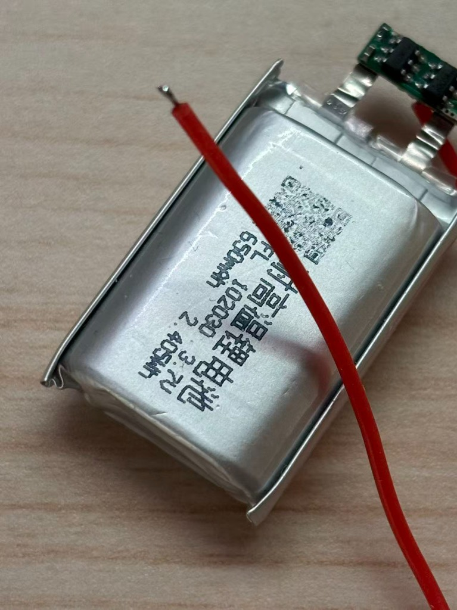</td>
    <td width="54%">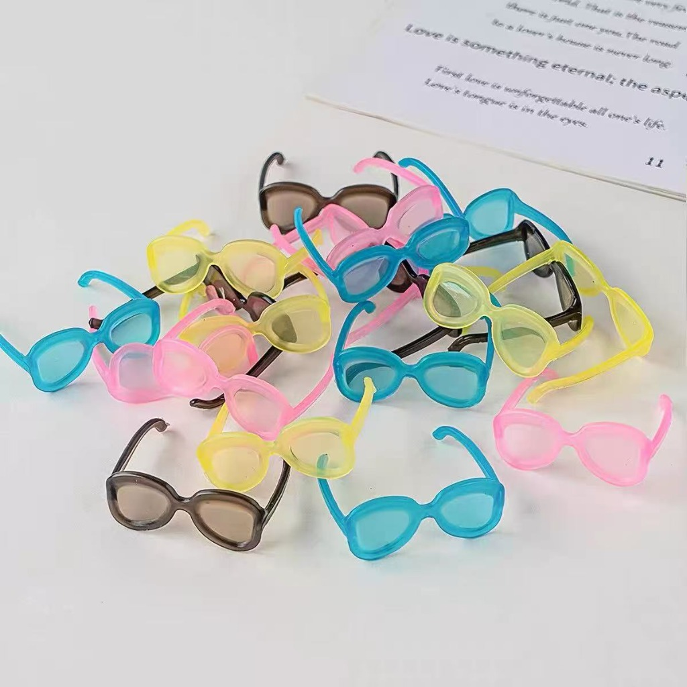</td>
  </tr>
  <tr align="center">
    <td><b>▲ Battery Reference</b>: Model <code>102030</code> (3.7V 650mAh protected LiPo)</td>
    <td><b>▲ Glasses Reference</b>: Off-the-shelf mini glasses (use image search)</td>
  </tr>
</table>

---

## 🔧 Assembly & Flashing

  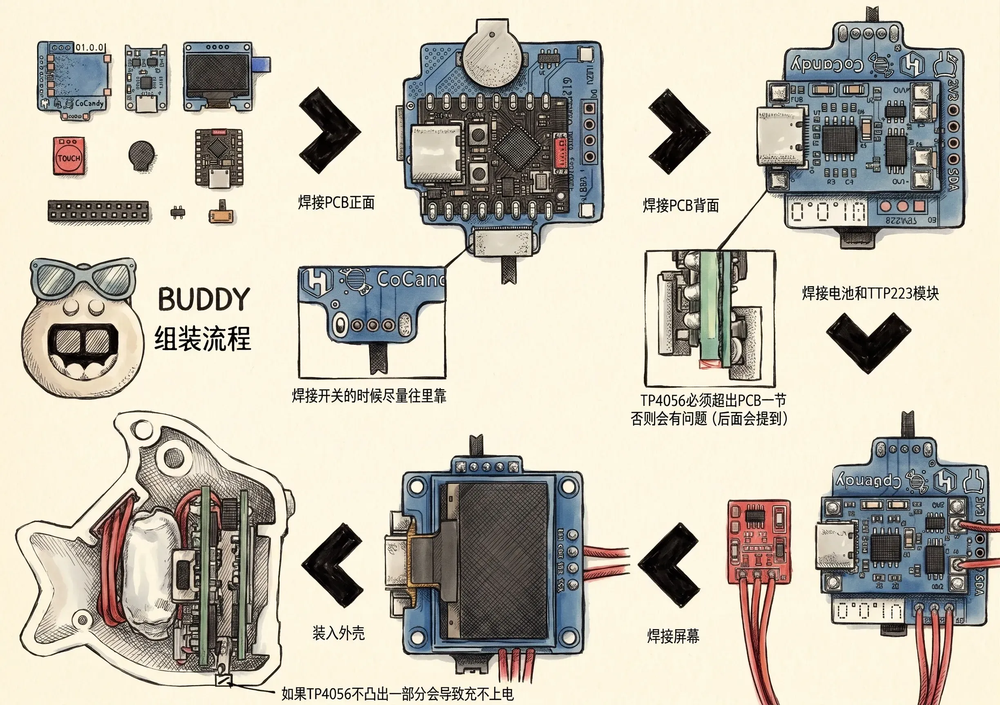

▲ Step-by-step soldering and enclosure assembly

> ⚠️ **2 Mechanical Fit Tips Before Soldering**
> - **Tip 1 (Push Switch Inward)**: Seat the `SK12D07V` slide switch **snug against the inner side of the PCB pads** so the actuator protrudes cleanly without binding against the shell.
> - **Tip 2 (Overhang the TP4056 Port)**: The USB Type-C end of the rear `TP4056` module **must overhang slightly past the PCB edge** (see callout above). Soldering it flush or recessed will prevent charging cables from plugging all the way in once enclosed.

1. **Solder Front SMD Parts & MCU**: Solder the two `2020 WS2812B` LEDs, `AO3400A` MOSFET, side-firing buzzer, `ESP32-C3 SuperMini` (flat via castellated pads), and side slide switch.
2. **Solder Rear TP4056 Charger**: Solder the `TP4056` module onto the back pads with its Type-C connector slightly overhanging the edge.
3. **Wire Touch Pad, Battery & OLED**: Use thin silicone wires for the `TTP223` touch module (slotted into the inner upper-back pocket during assembly) and LiPo leads, then solder the `0.96" OLED` onto `3V3 / GND / SCL / SDA` using a `4P` pin header.
4. **Test First, Snap Shut**: Power on to verify the screen before closing. Tuck the `102030` battery into the middle layer, route wires neatly, snap the left and right shells together, and put on the mini glasses.

### 1-Click Web Flashing & Self-Test

  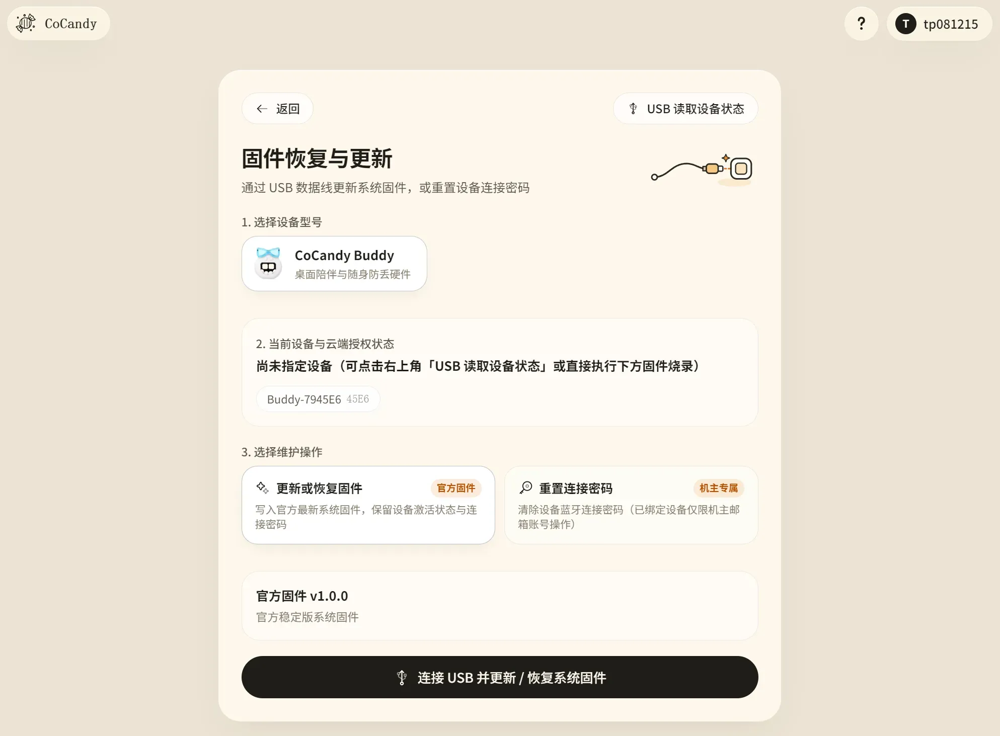

> ⚡ **Important Power Rule Before Plugging USB into `ESP32-C3` (Marked on PCB Silkscreen)**:  
> If the LiPo battery is connected, **always slide the side power switch to `OFF` before plugging a USB cable into the internal `ESP32-C3` Type-C port** for flashing or USB power, preventing `5V` from back-feeding into the battery rail! For normal daily charging, use the outer `TP4056` Type-C port at the bottom.

1. **USB Web Flashing**: Open 👉 **[https://home.cocandy.com.cn/flash](https://home.cocandy.com.cn/flash)** in desktop `Chrome` / `Edge`. With the side power switch **OFF**, plug a data cable into the **internal `ESP32-C3` Type-C port** (the outer `TP4056` port is charge-only; hold `BOOT` while plugging in if needed), select Buddy, and click flash.
2. **5-Second Self-Test & Activation**: On first boot, verify the buzzer and dual LEDs for free, then **hold the rear touch area for 5 seconds** as prompted on screen to complete hardware self-test. Open **[home.cocandy.com.cn](https://home.cocandy.com.cn)** to connect to `Buddy-XXXXXX` over Bluetooth and bind a per-device activation ticket from **[store.cocandy.com.cn](https://store.cocandy.com.cn)** (required from the 1st unit, permanently tied to chip hardware ID across reflashes).

<table align="center" width="100%">
  <tr align="center">
    <td width="50%">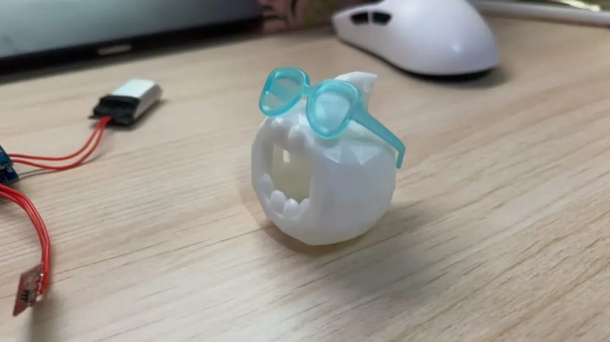</td>
    <td width="50%">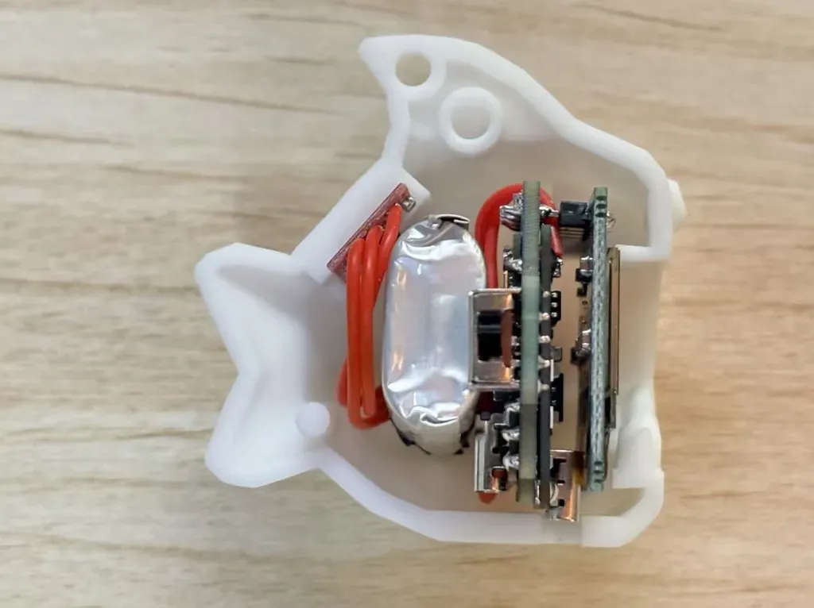</td>
  </tr>
  <tr align="center">
    <td><b>▲ Before Stuffing</b>: Empty test shell with early round glasses</td>
    <td><b>▲ Fully Packed</b>: Left-to-right: touch pad, LiPo cell, PCB stack, and OLED</td>
  </tr>
</table>

---

## 🎨 Modding & Custom Firmware

Alongside fabrication files (`.epro2` / Gerber) and print-ready `.stp` solids, this repository includes the editable **Rhino (`.3dm`) NURBS source** and **Blender (`.blend`) scene** so you can freely remix both the enclosure and the code:

### 1. Enclosure & Accessory Remixes
- **Mounting Docks & Clips**: Extend the `.3dm` / `.stp` geometry into a **magnetic desk dock**, **monitor top perch**, **quick-release backpack strap clip**, or **car vent mount**.
- **Character Mods**: Swap the tail or forehead facets for cat ears, devil horns, wind-up keys, or custom snap-on accessories.
- **Translucent & Specialty Filaments**: Because two bright `2020 WS2812B` LEDs sit inside the left and right cheeks, printing the shell in **translucent PETG, clear resin, glow-in-the-dark, or thermochromic filament** turns the whole body into a glowing diffuser.

### 2. Custom Open-Source Firmware (Hack It as a Pocket Dev Board)
Under the hood, the hardware is a self-contained pocket terminal packing **LiPo charging + `128×64 OLED` + dual RGB LEDs + capacitive touch + passive buzzer + `ESP32-C3` (Wi-Fi & BLE 5.0)**.

Using the **GPIO Pinout** table above and **[Bit-Eye-Lib](https://github.com/ByCoCandy/Bit-Eye-Lib)**, you can build your own firmware from scratch with **Arduino, PlatformIO, or ESP-IDF**:
- **🍅 Desk Pomodoro Timer**: Tap the back to start a 25-minute focus session with RGB breathing alerts and chiptune chimes.
- **📊 Tiny Wi-Fi Status Monitor**: Pull weather, GitHub stars, subscriber counts, or home-lab uptime over 2.4GHz Wi-Fi.
- **⌨️ BLE HID Macro Button**: Emulate a Bluetooth media/shortcut key to mute calls, skip tracks, or lock your screen with a tap.
- **🕹️ 1-Button Pixel Arcade**: Run custom Flappy Bird, Dino Runner, or virtual pet sketches on the `128×64` screen.

Built a cool shell remix or custom firmware? Open an Issue or PR to share your repo—we'd love to feature community mods here!

---

## 🤝 Community & License

### 🔄 Ongoing Updates
- **New Features Incoming**: Single-key mini games, BLE proximity finder, and new animations/web features are actively in development.
- **No-Disassembly Wireless OTA**: Existing builds never need PCB revisions or shell disassembly—future firmware updates install wirelessly over BLE via **[home.cocandy.com.cn](https://home.cocandy.com.cn)**.

### 💬 Get in Touch
- **🐧 QQ Group**: **`1042593321`** (build Q&amp;A, group buys, firmware news, and showcase photos)
- **🐛 Issues & Ideas**: Found a hardware/model quirk or have a feature idea? Open an **[Issue](https://github.com/ByCoCandy/buddy/issues)**.
- **⭐ Support**: If you enjoy this little project, consider giving the repo a **Star ⭐**!

### 📄 License & Commercial Sales Policy
- **Base Open-Source License**: All schematics, PCB files, 3D enclosure models, and documentation in this repository are licensed under **[CC BY-NC-SA 4.0](LICENSE)** (*Attribution-NonCommercial-ShareAlike 4.0 International*) for personal DIY builds and non-commercial remixes (or free custom firmware with **[Bit-Eye-Lib](https://github.com/ByCoCandy/Bit-Eye-Lib)**).
- **Per-Device Official Firmware Activation**: The precompiled device firmware and hosted CoCandy web services remain proprietary. **[home.cocandy.com.cn/flash](https://home.cocandy.com.cn/flash)** provides free 1-click USB flashing &amp; 5-second hardware self-test; unlocking the full system, web studio, and lifetime wireless OTA updates requires **per-device activation** from the 1st unit via **[store.cocandy.com.cn](https://store.cocandy.com.cn)** (1 code per device, permanently bound to chip hardware ID across reflashes).
- **Kits & Finished-Unit Sales (Official Firmware Ecosystem Only)**: Makers and third-party shops **are permitted to sell DIY component kits, 3D-printed shells, and assembled BUDDY units**—listings must visibly credit `BUDDY · CoCandy`; assembled units must be delivered pre-activated with unmodified official CoCandy firmware, and DIY kits must clearly inform buyers that official firmware requires per-device activation (or custom open-source firmware). **Commercial sale of this project's enclosure, PCB design, or derivative hardware preloaded or bundled with any third-party/modified firmware is strictly prohibited.** Third-party sellers assume sole responsibility for kit parts, soldering quality, battery safety, and after-sales warranty; CoCandy provides online web app and firmware support only. See [LICENSE](LICENSE) for full terms.

---

  

  <a href="https://cocandy.com.cn" target="_blank">CoCandy Website</a> &nbsp;·&nbsp;
  <a href="https://home.cocandy.com.cn" target="_blank">Device Hub</a> &nbsp;·&nbsp;
  <a href="https://store.cocandy.com.cn" target="_blank">Store</a> &nbsp;·&nbsp;
  <a href="https://home.cocandy.com.cn/flash" target="_blank">Web Flasher</a> &nbsp;·&nbsp;
  <a href="https://github.com/ByCoCandy/Bit-Eye-Lib" target="_blank">Bit-Eye-Lib</a>

